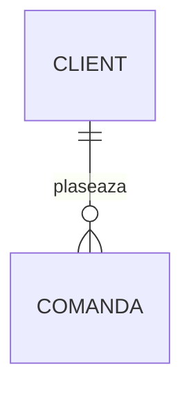

# Studiu

Aplicație web locală pentru pregătirea examenelor: notițe Markdown organizate în foldere,
import de materiale (PDF, audio, video, articole web), flashcard-uri cu repetiție spațiată,
quiz-uri, simulări de examen și chat cu notițele, cu trimitere la sursă.

Rulează pe laptopul tău (Ubuntu/Debian, Fedora sau Arch), ascultă doar pe `127.0.0.1`,
iar notițele rămân fișiere Markdown obișnuite. AI-ul e opțional și modular: implicit
Google Gemini (gratuit), dar orice model, inclusiv unul local (Ollama), merge fără modificări de cod.

Specificația completă: [`SPECIFICATIE.md`](SPECIFICATIE.md).

## Instalare și pornire

Ai nevoie de Python 3.11 sau mai nou.

```bash
./studiu.sh                 # pornește și deschide browserul
./studiu.sh --fara-browser  # doar pornește serverul
```

Prima rulare creează mediul virtual (`.venv`), instalează dependențele, copiază
`config.example.toml` în `config.toml` și creează configurația AI comună
(`~/.config/ai/ai.toml` și `~/.config/ai/.env`, cu permisiuni `600`) dacă lipsesc.
Aplicația se deschide la <http://127.0.0.1:8765>.

Pe **Ubuntu/Debian**, modulul `venv` vine separat; lansatorul îți spune comanda
(`sudo apt install python3-venv`). Pe Fedora și Arch e inclus.

Alte opțiuni ale lansatorului:

| Opțiune | Ce face |
|---|---|
| `--instaleaza-sistem [--distro debian\|fedora\|arch] [--da]` | instalează utilitarele opționale (ffmpeg, ocrmypdf, tesseract cu limba română); afișează comanda și o rulează doar după confirmare |
| `--instaleaza-transcriere` | instalează transcrierea locală (`faster-whisper`, câteva sute de MB) |
| `--instaleaza-serviciu` | pornire automată la login, ca serviciu systemd de utilizator |

Utilitarele opționale, pe distribuții (lista stă în [`distro.toml`](distro.toml)):

| Program | Ubuntu / Debian | Fedora | Arch |
|---|---|---|---|
| ffmpeg (audio/video) | `ffmpeg` | `ffmpeg-free` | `ffmpeg` |
| OCR pentru PDF-uri scanate | `ocrmypdf` | `ocrmypdf` | `ocrmypdf` |
| Tesseract + română | `tesseract-ocr tesseract-ocr-ron` | `tesseract tesseract-langpack-ron` | `tesseract tesseract-data-ron` |

Fără ele aplicația merge normal; doar importul de PDF-uri scanate și de video afișează
un mesaj cu comanda de instalare. Pagina **Setări** arată ce lipsește pentru distribuția ta.

## Configurare

### `config.toml`

Un `config.toml` gol funcționează. Cele mai importante opțiuni:

- `[notite].cale` – folderul cu notițe, de exemplu `"~/Notite"` (implicit `exemplu/`).
- `[notite].date` – cache-ul (`data/`); poate fi șters oricând, se reconstruiește singur.
- `[import]` – păstrarea surselor originale, OCR, mărimea bucăților trimise la AI.
- `[transcriere]` – `local` (faster-whisper), `api` (un furnizor cu `/audio/transcriptions`) sau `dezactivat`.
- `[carduri]`, `[repetitie]` – câte carduri pe secțiune, câte variante la quiz, carduri noi pe zi,
  retenția dorită.

### AI: `~/.config/ai/ai.toml` (comun cu Unelte)

Codul cere doar o **sarcină** (`notite`, `carduri`, `chat`, `cuvinte_cheie`), iar fișierul
decide ce model o execută. Cheile stau în `~/.config/ai/.env`, niciodată în repo.

**Gemini (implicit, gratuit):** generează o cheie în Google AI Studio (fără card) și pune-o în
`~/.config/ai/.env`:

```
GEMINI_API_KEY=cheia-ta
```

Test: `.venv/bin/python -m app.ai test`. Alte comenzi: `... modele gemini` (modelele
disponibile), `... sarcini` (tabelul sarcină → model), `... consum` (consumul lunii).
Pe free tier, datele trimise pot fi folosite de Google pentru îmbunătățirea produselor;
notițele de curs de regulă nu sunt sensibile, dar e bine să știi.

**Ollama (local, fără cheie):** pornește Ollama, descarcă un model (`ollama pull qwen3:8b`) și
schimbă în `ai.toml`:

```toml
implicit = "ollama:qwen3:8b"
```

Pe un laptop fără placă video dedicată, modelele locale sunt lente, iar cele mici greșesc mai des
(mai ales în română): potrivite pentru `cuvinte_cheie` (`rapid`), mai puțin pentru notițe și carduri.

**Un furnizor plătit (de exemplu Anthropic sau OpenAI):** decomentează secțiunea lui din `ai.toml`,
pune cheia în `.env`, setează prețurile (`pret_intrare_1m`, `pret_iesire_1m`) și eventual
`[buget].lunar_usd`, apoi folosește-l per sarcină:

```toml
[sarcini]
carduri = "anthropic:<model>"
```

Importul, generarea de carduri și chatul au în interfață un selector „Model”; alegerea e doar
pentru acea operație și nu modifică fișierul. Operațiile scumpe afișează înainte o estimare de
tokeni și de cost („gratuit” pe free tier sau pe modele locale).

## Cum îți organizezi notițele

```
Notite/
├── Management/                      ← materie
│   ├── Management antreprenorial/   ← subtopic
│   │   ├── 01 Curs 1 - Introducere.md
│   │   └── 02 Seminar 1.md
│   └── Managementul proiectelor/
│       └── 01 Curs 1.md
├── Baze de date/
│   └── 01 Normalizare.md
└── .studiu/                         ← datele aplicației (carduri, repetiții, examene…)
```

- Fiecare folder e o materie, un topic sau un subtopic, pe oricâte niveluri.
- Prefixul numeric (`01 `, `02-`, `03_`) stabilește ordinea și nu se afișează.
- Titlul notiței e primul `# ...` din fișier (sau `titlu:` din antet, sau numele fișierului).
- Fișierele și folderele care încep cu `.` sunt ignorate în arbore.
- Poți edita notițele și în alt editor: aplicația observă modificările automat.
- Formulele: `$...$` în text și `$$...$$` pe rând separat.
- Linkurile între notițe: căi relative, de exemplu `[Seminarul 1](02%20Seminar%201.md)`.
  La redenumire sau mutare, linkurile din alte notițe **nu** se actualizează automat.
- Ștergerea din aplicație mută fișierele în `.studiu/cos/<data>/`; nimic nu se șterge definitiv.

### Diagrame (Mermaid)

Diagramele simple care fac parte din materie se scriu ca text, în blocuri `mermaid`:

````markdown

````

Tipuri recomandate: `flowchart`, `sequenceDiagram`, `classDiagram`, `erDiagram`, `stateDiagram`.
Desenele libere țin de Excalidraw, proiectarea reală a bazelor de date de ChartDB (din Unelte);
exporturile lor (SVG/PNG) se inserează cu ``.

### Antetul notițelor

```yaml
---
id: k7m2q9xa      # adăugat automat la import sau la prima generare de carduri; nu-l schimba
sursa: ai         # ai | web | manual (lipsă = manual)
verificat: false  # notițele AI apar în „De revizuit” până le verifici
---
```

Doar notițele verificate (sau scrise de tine) se folosesc pentru carduri. Câmpurile necunoscute
din antet sunt păstrate.

### Carduri scrise de mână (fără AI)

```markdown
Q: Ce măsoară lichiditatea curentă?
A: Capacitatea firmei de a-și acoperi datoriile curente
din activele circulante.

Lichiditatea curentă = {{c1::Active circulante}} / {{c2::Datorii curente}}
```

`Q:`/`A:` pe linii consecutive (răspunsul continuă până la o linie goală) dă un card întrebare–răspuns;
un paragraf cu `{{c1::...}}` dă câte un card de completare pentru fiecare număr. Cardurile
generate de AI devin **orfane** când secțiunea lor se modifică; le găsești în „De revizuit”.

## Scurtături

| Tastă | Unde | Acțiune |
|---|---|---|
| `/` | oriunde | caută în notițe |
| `E` | notiță | editează |
| `Ctrl+S`, `Esc` | editor | salvează, închide |
| `Spațiu` | repetiție | arată răspunsul |
| `1`–`4` | repetiție | Din nou / Greu / Bine / Ușor |
| `1`–`4`, `Enter` | quiz | alege varianta, următoarea întrebare |
| `1`–`4`, `←` `→` | examen | alege varianta, navighează |

## Backup cu Git

Tot ce contează stă în folderul de notițe (inclusiv `.studiu/`: carduri, istoricul repetițiilor,
examene, prompturi personalizate), deci îl pui sub Git ca pe orice folder:

```bash
cd ~/Notite && git init && git add -A && git commit -m "notițe"
```

Istoricul repetițiilor e în fișiere lunare doar cu adăugare, deci sincronizarea între calculatoare
aproape nu are conflicte. Sursele binare (PDF, audio) nu intră în Git dacă
`[import].versioneaza_sursele = false` (implicit). Comanda `backup` din Unelte face commit și push automat.

`data/` e doar cache și nu are nevoie de backup.

## Prompturi personalizate

Prompturile implicite sunt în `app/prompts/`. Ca să schimbi unul, copiază-l în
`<notițe>/.studiu/prompturi/` și editează copia: are prioritate și supraviețuiește actualizărilor.

## Depanare

- **„Lipsește cheia pentru furnizorul gemini”** – pune `GEMINI_API_KEY=...` în `~/.config/ai/.env`.
- **„Modelul X nu mai e disponibil”** – numele modelelor se schimbă; vezi lista cu
  `.venv/bin/python -m app.ai modele gemini` și actualizează `ai.toml`.
- **Limită de rată (429)** – aplicația reîncearcă singură; dacă se întâmplă des, pune
  `cereri_pe_minut = 10` la furnizor în `ai.toml`.
- **PDF scanat** – instalează ocrmypdf și tesseract (`./studiu.sh --instaleaza-sistem`).
- **Ceva arată ciudat după o actualizare** – Setări → „Reconstruiește cache-ul” (sau șterge `data/`).
- **Jurnal** – `data/studiu.log`.
- **O sarcină a rămas „eroare” după o oprire** – apasă „Reia” în pagina Import.

## Dependențe

Toate fixate exact în `requirements.txt`: FastAPI + uvicorn (serverul), python-multipart (cerut de
FastAPI pentru încărcarea fișierelor la import), markdown-it-py + mdit-py-plugins (randare),
PyYAML (antetul notițelor), PyMuPDF (PDF), trafilatura (articole web), fsrs (repetiția spațiată,
învelit în `app/srs.py`). Transcrierea locală (`requirements-transcriere.txt`) se instalează doar
la cerere. KaTeX și Mermaid sunt incluse în `app/static/vendor/` (fără CDN).

Importul din YouTube (opțional în specificație) nu e implementat: ar cere `yt-dlp`, care trebuie
actualizat des și deci nu e „set and forget”.

## Teste

```bash
.venv/bin/pip install -r requirements-dev.txt
.venv/bin/python -m pytest
```

Testele nu folosesc rețeaua și nici chei reale: AI-ul e înlocuit de servere false locale
(format OpenAI și Anthropic).

## Structura codului

```
app/
├── main.py        serverul web și rutele /api/*
├── library.py     arbore, citire/scriere notițe, antet, căi sigure, mutare, coș
├── index.py       cache: notițe, secțiuni, căutare FTS5 fără diacritice
├── cache.py       baza SQLite din data/ (doar date derivate)
├── storage.py     .studiu/: JSON și JSONL scrise atomic
├── sections.py    secțiunile ## cu ancore identice cu HTML-ul
├── cards.py       carduri manuale, generate cu AI, orfane
├── srs.py         repetiția spațiată (fsrs)
├── reviews.py     istoricul răspunsurilor și coada zilei
├── quiz.py        quiz, examen, statistici
├── chat.py        chat cu notițele (FTS + AI)
├── importer.py    import web, PDF (OCR), audio/video
├── transcriere.py faster-whisper local sau API
├── jobs.py        sarcinile de durată (un fir de lucru)
├── system.py      distribuția și utilitarele opționale
├── prompts/       prompturile implicite
├── ai/            stratul AI comun (identic cu cel din Unelte)
└── static/        interfața (HTML, CSS, module JS, KaTeX și Mermaid locale)
```
