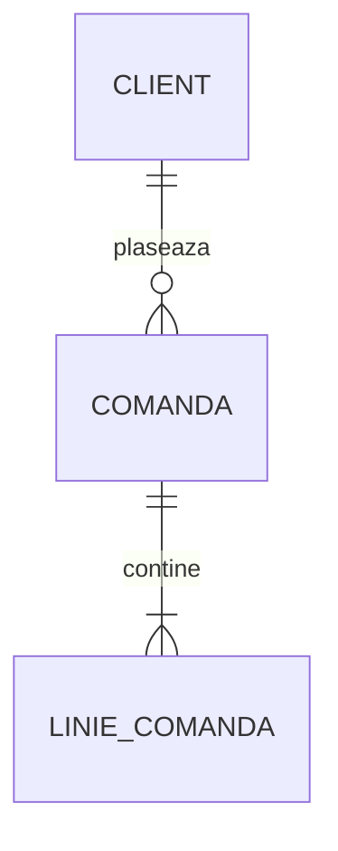

# Studiu – specificația proiectului

Document de implementare pentru aplicația **Studiu**: o aplicație web locală pentru notițe,
import de materiale, flashcard-uri, quiz-uri, simulări de examen și chat cu notițele.
Scopul ei e unul singur: **pregătirea pentru examene și teste**.

Sisteme țintă: **Ubuntu / Debian**, **Fedora** și **Arch**, cu orice mediu grafic.

Documentul e scris pentru implementare de către un agent de cod. Tot ce e marcat **TREBUIE**
e obligatoriu; ce e marcat **POATE** e opțional.

---

## 1. Scop și principii

### 1.1 Ce rezolvă

Înlocuiește platformele plătite de rezumate, flashcard-uri și quiz-uri cu o aplicație proprie care:

- ține notițele ca fișiere Markdown obișnuite, organizate în foldere;
- generează notițe din PDF-uri, înregistrări audio/video și articole web;
- generează flashcard-uri și întrebări de quiz din notițe, cu **orice model AI** (implicit
  Gemini, gratuit; vezi 5.1);
- programează repetițiile cu un algoritm de repetiție spațiată;
- simulează examene și arată capitolele slabe;
- răspunde la întrebări folosind doar notițele, cu trimitere la sursă.

Orice funcție care nu servește direct pregătirii pentru examene rămâne în afara aplicației
(vezi 14).

Un singur utilizator, pe laptopul propriu (Linux: Ubuntu, Fedora sau Arch). Mai târziu va fi mutată pe un server
personal și va primi un client Flutter (vezi secțiunea 13).

### 1.2 Principii „set and forget” (TREBUIE respectate în toate deciziile)

1. **Folderul de notițe e singura sursă de adevăr.** Tot ce contează (notițe, carduri,
   istoricul repetițiilor, rezultatele examenelor, prompturile personalizate) stă în fișiere
   text în folderul de notițe, ușor de pus sub Git. Baza SQLite din `data/` e doar un cache:
   poate fi ștearsă oricând și se reconstruiește singură la pornire.
2. **Un singur proces, o singură comandă.** Fără Docker obligatoriu, fără Redis, fără Celery,
   fără cron extern, fără server de baze de date. Sarcinile lungi rulează într-un fir de lucru
   din același proces.
3. **Fără pas de build pentru interfață.** HTML, CSS și JavaScript simplu, fără framework,
   fără npm la rulare. Bibliotecile externe (KaTeX, Mermaid) sunt incluse local în `app/static/vendor/`.
   Fără CDN-uri.
4. **Puține dependențe, versiuni fixate exact.** Fiecare dependență nouă trebuie justificată.
   Dependențele grele și opționale stau într-un fișier separat.
5. **Degradare elegantă.** Fără cheie AI, tot ce nu are nevoie de AI funcționează normal
   (bibliotecă, căutare, carduri scrise manual, repetiție, quiz din carduri existente).
   Fără `ffmpeg` sau transcriere locală, importul audio/video afișează un mesaj clar,
   restul aplicației merge.
6. **Nu pierde niciodată date.** Scrieri atomice (fișier temporar + `os.replace`), detecție
   de conflict la salvare, ștergerile mută fișierele într-un coș (`.studiu/cos/`), nu le șterg.
7. **AI modular, fără SDK-uri de furnizor.** Orice funcție AI poate rula pe orice model
   (cloud sau local), ales din configurație, per sarcină. Comunicarea se face prin HTTP simplu,
   prin adaptoare mici (vezi 5.1); un furnizor nou nu modifică restul codului.
8. **Costuri controlate.** Fiecare apel AI e contorizat, există un buget lunar, iar
   operațiile scumpe afișează o estimare înainte de a porni.

---

## 2. Starea actuală (punctul de plecare)

Există deja o implementare funcțională a modulului **Bibliotecă**. Implementarea nouă
TREBUIE să pornească de la ea și să-i păstreze convențiile.

```
studiu/
├── studiu.sh              lansator: creează .venv, instalează, pornește
├── config.example.toml    copiat în config.toml la prima rulare
├── requirements.txt
├── README.md
├── exemplu/               notițe de exemplu
└── app/
    ├── __main__.py        pornește uvicorn, deschide browserul
    ├── config.py          citește config.toml (dataclass Config, obiect global CFG)
    ├── main.py            FastAPI, rutele /api/*
    ├── library.py         arbore, citire/scriere notițe, antet YAML, căi sigure
    ├── index.py           SQLite: metadate + căutare FTS5 fără diacritice
    ├── render.py          Markdown → HTML (markdown-it-py + pluginuri)
    ├── ai.py              client AI compatibil OpenAI (urllib)
    └── static/            index.html, style.css, app.js, vendor/katex
```

Funcționează deja:

- arbore de materii pe oricâte niveluri, citit din foldere; prefixul numeric din nume
  (`01 Curs 1.md`) stabilește ordinea și nu se afișează;
- vizualizare cu formule (KaTeX), tabele, cod, liste de sarcini, note de subsol,
  linkuri relative între notițe, imagini relative;
- editor cu previzualizare, `Ctrl+S`, detecție de conflict (409) dacă fișierul a fost
  modificat în alt editor;
- creare de materii, subtopicuri și notițe;
- căutare full-text care ignoră diacriticele, cu fallback pe forme apropiate ale cuvintelor;
- lista „De revizuit” pentru notițele cu `sursa: ai` și `verificat: false`;
- reindexare incrementală după `mtime`, deci editarea din alt editor e preluată automat.

Convenții de păstrat:

- textele din interfață și mesajele de eroare sunt în **română**;
- identificatorii din cod sunt în **engleză**;
- rutele API sunt în română (`/api/notita`, `/api/arbore`, `/api/cautare`);
- serverul ascultă doar pe `127.0.0.1`.

---

## 3. Stiva tehnică

| Componentă | Alegere | Motiv |
|---|---|---|
| Limbaj | Python 3.11+ | `tomllib` inclus, ecosistem matur |
| Server web | FastAPI + uvicorn | deja folosit |
| Bază de date | SQLite (modulul standard `sqlite3`) | un fișier, fără server, FTS5 inclus |
| Markdown | markdown-it-py + mdit-py-plugins | deja folosit |
| Extragere PDF | PyMuPDF | rapid, extragere bună, un singur pachet |
| Articole web | trafilatura | extrage doar conținutul principal |
| Repetiție spațiată | pachetul `fsrs` (versiune fixată), învelit într-un modul propriu | algoritm modern, înlocuibil |
| AI | strat AI propriu cu adaptoare (`openai`, `anthropic`), comun cu Unelte; implicit Gemini free tier | orice model, ales per sarcină din config (vezi 5.1) |
| Transcriere locală (opțional) | faster-whisper | instalabil din pip, rulează pe CPU |
| Utilitare de sistem (opționale) | `ffmpeg`, `ocrmypdf` + `tesseract` | detectate la pornire, nu obligatorii |
| Interfață | HTML + CSS + JS simplu, KaTeX și Mermaid incluse local | fără build |

### 3.1 Fișiere de dependențe

- `requirements.txt` – dependențele de bază, **versiuni exacte** (`==`).
- `requirements-transcriere.txt` – `faster-whisper` și ce mai trebuie pentru transcriere locală.
- `requirements-dev.txt` – `pytest`, `httpx` (pentru `TestClient`).

`studiu.sh` instalează automat `requirements.txt`. Transcrierea locală se instalează explicit:
`./studiu.sh --instaleaza-transcriere`.

Limită orientativă: maximum 8 dependențe directe în `requirements.txt`.

---

## 4. Structura datelor

### 4.1 Folderul de notițe

```
Notite/                                   ← [notite].cale din config
├── Management/
│   ├── Management antreprenorial/
│   │   ├── 01 Curs 1 - Introducere.md
│   │   └── 02 Seminar 1.md
│   └── Managementul proiectelor/
│       └── 01 Curs 1.md
├── Baze de date/
│   └── 01 Normalizare.md
└── .studiu/                              ← datele aplicației, versionabile cu Git
    ├── carduri/<id-notita>.json
    ├── repetitii/2026-10.jsonl
    ├── examene/2026-10-21T18-30-00.json
    ├── surse/<id-sursa>.<ext>            ← opțional, sursele originale
    ├── surse/<id-sursa>.txt              ← textul extras sau transcrierea
    ├── prompturi/                        ← suprascrieri ale prompturilor implicite
    ├── cos/                              ← fișiere „șterse”
    └── .gitignore                        ← generat: ignoră surse/*.pdf, *.mp3 etc. dacă
                                             [import].versioneaza_sursele = false
```

Folderele și fișierele care încep cu `.` nu apar în arbore (comportament existent).

### 4.2 Antetul notițelor (frontmatter YAML)

Toate câmpurile sunt opționale. Aplicația TREBUIE să păstreze câmpurile necunoscute
și ordinea lor când rescrie antetul.

```yaml
---
id: k7m2q9xa            # adăugat automat la import sau la prima generare de carduri
titlu: Rate de lichiditate
sursa: ai               # ai | web | manual (lipsă = manual)
verificat: false        # relevant doar pentru sursa: ai
sursa_fisier: k3p8w1zd  # id-ul sursei din .studiu/surse/, dacă există
sursa_url: https://...  # pentru articole web
generat_la: 2026-10-20T21:40:00+03:00
---
```

Reguli:

- `id`: 8 caractere `[a-z0-9]`, aleatoriu, unic. Se adaugă doar când e nevoie (import,
  generare de carduri) și nu se mai schimbă niciodată. Leagă cardurile de notiță chiar
  dacă notița e redenumită sau mutată.
- O notiță e **utilizabilă pentru carduri** dacă `sursa` nu e `ai`, sau dacă `verificat`
  e adevărat (`true`, `da`, `yes`, `1`).
- Notițele cu `sursa: web` sunt utilizabile direct (conținutul nu e generat de AI).
- Notițele cu `tip: rezumat` (rezumatele zilnice create de comanda `rezumat` din Unelte, dacă
  sunt salvate în folderul de notițe) se afișează și se caută normal, dar **nu** apar în
  „De revizuit” și nu se folosesc pentru carduri.

### 4.3 Secțiuni

O **secțiune** e un bloc care începe cu un titlu `##` și ține până la următorul `##`
sau până la final. Textul dinaintea primului `##` formează secțiunea de introducere.
O notiță fără `##` e o singură secțiune.

Fiecare secțiune are:

- `ancora` – slug-ul titlului, identic cu `id`-ul generat de `anchors_plugin` la randare
  (ca linkul `notita#ancora` să ducă exact acolo);
- `hash` – SHA-256 pe primele 16 caractere hex, calculat din textul secțiunii normalizat
  (spații comprimate, fără spații la capete).

### 4.4 Cardurile: `.studiu/carduri/<id-notita>.json`

Un fișier per notiță. Format:

```json
{
  "versiune": 1,
  "notita_id": "k7m2q9xa",
  "notita_cale": "Analiză financiară/01 Rate de lichiditate.md",
  "carduri": [
    {
      "id": "c4n8r2tq",
      "tip": "intrebare",
      "sectiune": "lichiditatea-curentă",
      "sectiune_hash": "9f2c1a7b3e4d5f60",
      "intrebare": "Ce măsoară lichiditatea curentă?",
      "raspuns": "Capacitatea firmei de a-și acoperi datoriile curente din activele circulante.",
      "variante": [
        "Capacitatea firmei de a-și acoperi datoriile curente din activele circulante.",
        "Rentabilitatea capitalurilor proprii.",
        "Gradul de îndatorare pe termen lung.",
        "Viteza de rotație a stocurilor."
      ],
      "corect": 0,
      "explicatie": "Se calculează ca active circulante / datorii curente.",
      "origine": "ai",
      "stare": "activ",
      "creat_la": "2026-10-20T21:40:00+03:00",
      "modificat_manual": false
    }
  ]
}
```

Câmpuri:

- `tip`: `intrebare` (întrebare–răspuns, cu variante opționale) sau `completare` (cloze).
  Pentru `completare`, `intrebare` conține textul cu golul marcat `{{c1::...}}`, iar
  `raspuns` conține textul complet.
- `variante` și `corect`: opționale; dacă lipsesc, cardul apare în quiz cu variante
  generate din răspunsurile altor carduri din același topic (vezi 6.5.5).
- `origine`: `ai` sau `manual` (extras din sintaxa din notiță, vezi 6.5.1).
- `stare`: `activ`, `suspendat` (exclus din repetiții și quiz-uri), `orfan` (secțiunea
  sursă a dispărut sau a fost schimbată – vezi 6.5.4).
- `modificat_manual`: devine `true` când utilizatorul editează cardul; cardurile editate
  manual nu sunt niciodată înlocuite automat la regenerare.

`notita_cale` e doar informativ (ultima cale cunoscută); legătura reală se face prin `id`.

### 4.5 Istoricul repetițiilor: `.studiu/repetitii/AAAA-LL.jsonl`

Fișiere lunare, **doar adăugare** (append-only), o linie JSON per răspuns:

```json
{"t":"2026-10-21T08:12:44+03:00","card":"c4n8r2tq","nota":3,"ms":5400,"mod":"repetitie"}
{"t":"2026-10-21T18:31:02+03:00","card":"b2k9x1mf","corect":false,"mod":"examen","examen":"2026-10-21T18-30-00"}
```

- `nota`: 1 = Din nou, 2 = Greu, 3 = Bine, 4 = Ușor (doar pentru `mod: repetitie`).
- `corect`: pentru `mod: quiz` și `mod: examen`.
- Starea de programare a fiecărui card **nu se salvează în fișiere**: se obține reluând
  istoricul (replay) prin algoritmul de repetiție. Rezultatul e ținut în cache-ul SQLite.
- Un răspuns greșit în quiz sau examen se tratează în programare ca nota 1 (cardul revine
  curând la repetiție). Un răspuns corect în quiz sau examen nu modifică programarea.

Formatul append-only face sincronizarea prin Git aproape fără conflicte.

### 4.6 Examenele: `.studiu/examene/<timestamp>.json`

```json
{
  "versiune": 1,
  "inceput": "2026-10-21T18:30:00+03:00",
  "terminat": "2026-10-21T18:52:10+03:00",
  "scop": "Analiză financiară",
  "durata_limita_min": 30,
  "intrebari": [
    {"card": "c4n8r2tq", "ales": 2, "corect": 0, "ms": 21000}
  ],
  "scor": {"corecte": 14, "total": 20}
}
```

### 4.7 Consumul AI

Consumul se înregistrează de stratul AI comun în `~/.local/state/ai/consum/AAAA-LL.jsonl`,
împreună cu Unelte (vezi 5.1). Studiu scrie cu `"aplicatie": "studiu"` și citește aceleași
fișiere pentru pagina Setări.

### 4.8 Cache-ul SQLite: `data/cache.db`

Conține doar date derivate. TREBUIE să poată fi șters fără pierderi. Schema e versionată cu
`PRAGMA user_version`; la o versiune diferită, cache-ul se șterge și se reconstruiește
(fără sistem de migrări).

Tabele orientative:

- `files`, `notes_fts` – existente (metadate notițe și căutare);
- `sections` – secțiunile fiecărei notițe (note_id, ancora, titlu, hash, text) +
  `sections_fts` pentru chat;
- `cards` – copie a cardurilor din JSON, pentru interogări rapide;
- `card_state` – starea de programare obținută din replay (scadență, stabilitate etc.);
- `sources_fts` – textul surselor importate, pentru chat;
- `jobs` – sarcinile în curs (vezi 6.1).

Sincronizarea cache-ului e incrementală, după `mtime` și dimensiune (ca în `index.py`).

---

## 5. Configurare (`config.toml`)

Toate opțiunile au valori implicite rezonabile; un `config.toml` gol TREBUIE să funcționeze.

```toml
[notite]
cale = "~/Notite"
date = "data"

[server]
host = "127.0.0.1"
port = 8765

[ai]
# Furnizorii, modelele și ce model folosește fiecare sarcină se configurează
# în fișierul comun ~/.config/ai/ai.toml (vezi 5.1). Aici nu e nevoie de nimic.

[import]
pastreaza_sursele = true    # copiază fișierul original în .studiu/surse/
versioneaza_sursele = false # false = sursele binare sunt puse în .studiu/.gitignore
caractere_per_bucata = 12000
ocr = true                  # folosește ocrmypdf pentru PDF-uri scanate, dacă e instalat

[transcriere]
mod = "local"               # local | api | dezactivat. Gemini nu transcrie prin API (vezi 5.1)
model_local = "small"       # tiny | base | small | medium
limba = "ro"
model_api = "openai:whisper-1"  # pentru mod = "api": furnizor de tip openai cu /audio/transcriptions

[carduri]
per_sectiune_min = 2
per_sectiune_max = 6
variante_quiz = 4

[repetitie]
carduri_noi_pe_zi = 20
retentie_dorita = 0.9
```

Cheile stau în `~/.config/ai/.env`, niciodată în `config.toml` sau în folderul de notițe.

### 5.1 Stratul AI comun (modular)

Orice funcție AI poate folosi **orice model, de la orice furnizor, inclusiv modele locale**,
fără modificări de cod. Codul cere doar o **sarcină** (de exemplu `carduri` sau `traducere`),
iar stratul AI decide, după configurație, ce furnizor și ce model o execută.

Același strat AI e folosit de **Studiu** și de **Unelte**, cu același fișier de configurare și
aceleași chei. Codul (pachetul `ai/`) e copiat intenționat în ambele proiecte, cu constanta
`AI_LAYER_VERSION`, ca fiecare proiect să poată fi actualizat independent. Textul acestei
secțiuni e identic în ambele specificații.

**Fișiere**

- `~/.config/ai/ai.toml` – furnizori, aliasuri, ce model folosește fiecare sarcină;
- `~/.config/ai/.env` – cheile (`NUME=valoare`), permisiuni `600`. Stratul AI îl citește
  singur (nu depinde de lansator); variabilele de mediu deja setate au prioritate;
- `~/.local/state/ai/consum/AAAA-LL.jsonl` – consumul, comun ambelor proiecte;
- variabila de mediu `AI_CONFIG` poate indica alt fișier de configurare (folosită în teste);
- instalatoarele ambelor proiecte creează fișierele din `ai.example.toml` dacă lipsesc și
  **nu le suprascriu niciodată**.

**Formatul `ai.toml`**

```toml
# Modelul folosit când o sarcină nu are altă setare
implicit = "gemini:gemini-3.8-flash"

[aliasuri]                       # nume scurte, folosite mai jos și în interfețe
rapid = "gemini:gemini-3.8-flash"
bun   = "gemini:gemini-3.8-flash"
# local = "ollama:<numele modelului din Ollama>"

[sarcini]                        # o sarcină lipsă folosește `implicit`
notite        = "bun"            # Studiu: notițe din PDF / transcrieri
carduri       = "bun"            # Studiu
chat          = "bun"            # Studiu
cuvinte_cheie = "rapid"          # Studiu: pasul 1 din chat
corectura_ocr = "rapid"          # Unelte: ocr-ecran --ai
stil          = "bun"            # Unelte: corecteaza --stil
traducere     = "bun"            # Unelte
cv            = "bun"            # Unelte
buget         = "rapid"          # Unelte: categorisire
rezumat       = "rapid"          # Unelte: rezumatul zilnic

[buget]
lunar_usd = 0                    # 0 = fără limită; contează doar furnizorii cu preț

[furnizori.gemini]
tip = "openai"                   # adaptorul: openai | anthropic
base_url = "https://generativelanguage.googleapis.com/v1beta/openai"
cheie = "GEMINI_API_KEY"         # NUMELE variabilei din .env, nu cheia
cereri_pe_minut = 0              # >0 dacă primești des erori 429
timeout_s = 180
schema_json = "auto"             # auto | da | nu
context_max = 0                  # tokeni; 0 = necunoscut
max_iesire = 8192
pret_intrare_1m = 0.0            # USD / 1M tokeni (0 = gratuit)
pret_iesire_1m = 0.0

[furnizori.ollama]               # modele locale; la fel LM Studio, llama.cpp server
tip = "openai"
base_url = "http://127.0.0.1:11434/v1"
cheie = ""                       # fără cheie
timeout_s = 900                  # modelele locale sunt lente pe CPU
context_max = 8192

# [furnizori.groq]
# tip = "openai"
# base_url = "https://api.groq.com/openai/v1"
# cheie = "GROQ_API_KEY"

# [furnizori.openrouter]
# tip = "openai"
# base_url = "https://openrouter.ai/api/v1"
# cheie = "OPENROUTER_API_KEY"

# [furnizori.openai]
# tip = "openai"
# base_url = "https://api.openai.com/v1"
# cheie = "OPENAI_API_KEY"

# [furnizori.anthropic]
# tip = "anthropic"
# base_url = "https://api.anthropic.com/v1"
# cheie = "ANTHROPIC_API_KEY"
```

Un fișier lipsă sau gol TREBUIE să funcționeze: valoarea implicită e furnizorul `gemini`
de mai sus. Fără cheie, funcțiile AI se opresc cu un mesaj care spune exact ce variabilă
lipsește și în ce fișier; tot restul aplicației merge normal.

**Referințe la modele și rezolvare**

- o referință e `furnizor:model` (despărțită la **primul** `:`, deci `ollama:qwen3:8b` e valid)
  sau numele unui alias;
- ordinea: alegerea explicită (opțiunea `--model` în Unelte, selectorul din interfață în Studiu)
  → `[sarcini]` → `implicit`;
- un alias poate trimite la alt alias (maximum 3 niveluri); ciclurile și furnizorii
  nedeclarați dau eroare clară la pornire, nu la primul apel.

**Adaptoare** (`ai/adaptoare/`)

Interfața unui adaptor:

```python
class Adaptor(Protocol):
    def chat(self, cerere: CerereChat) -> RaspunsChat: ...
    def modele(self) -> list[str]: ...
```

`CerereChat`: model, mesaje (`system` / `user` / `assistant`, text), temperatură, `max_iesire`,
schemă JSON opțională. `RaspunsChat`: text, tokeni de intrare, tokeni de ieșire, dacă tokenii
sunt estimați, motivul opririi.

Adaptoare obligatorii:

- **`openai`** – `POST {base_url}/chat/completions`, `Authorization: Bearer` (doar dacă există
  cheie), `response_format` de tip `json_schema` când există schemă și furnizorul o acceptă,
  tokeni din `usage.prompt_tokens` / `usage.completion_tokens`, modele din `GET {base_url}/models`.
  Acoperă Gemini, OpenAI, Groq, OpenRouter, Mistral, DeepSeek, Ollama, LM Studio,
  llama.cpp server, vLLM.
- **`anthropic`** – `POST {base_url}/messages`, antetele `x-api-key` și `anthropic-version`
  (valoarea din documentația curentă, ținută ca o constantă), mesajul `system` separat,
  `max_tokens` obligatoriu (din `max_iesire`), textul din blocurile de tip `text`, tokeni din
  `usage.input_tokens` / `usage.output_tokens`, modele din `GET {base_url}/models`. JSON-ul
  se cere prin prompt și se validează (`schema_json` tratat ca `nu`).

Un furnizor nou cu API diferit = **un singur fișier** nou în `ai/adaptoare/` plus o intrare în
dicționarul `ADAPTOARE`. Nicio altă parte a codului nu se modifică. Fără SDK-uri de furnizor:
doar `urllib` din biblioteca standard.

**Stratul comun** (`ai/client.py`)

```python
def ruleaza(sarcina: str, mesaje: list[dict], *, model: str | None = None,
            schema: dict | None = None, temperatura: float = 0.3,
            la_progres: Callable[[str], None] | None = None) -> Rezultat
def modele_configurate() -> dict        # aliasuri, sarcini → model rezolvat, furnizori
def listeaza_modele(furnizor: str) -> list[str]
def testeaza(model: str | None = None) -> Diagnostic
def estimeaza_tokeni(text: str) -> int  # len(text) / 3.5, rotunjit în sus
def estimeaza_cost(sarcina: str, tokeni_intrare: int, tokeni_iesire: int) -> float | None
```

Răspunderi:

- **rezolvarea modelului** și încărcarea cheii;
- **limitarea ritmului** per furnizor (`cereri_pe_minut`: pauză minimă între apeluri,
  `time.monotonic()` + lock);
- **reîncercări**: HTTP 429 – până la 4, cu pauza din `Retry-After` sau 5 / 15 / 45 / 90 s;
  HTTP 5xx și erori de rețea temporare – până la 2; alte erori 4xx – fără reîncercare;
  fiecare pauză e anunțată prin `la_progres` („Limită de rată la gemini, reiau în 45 s”);
- **mesaje de eroare în română**, distincte: cheie lipsă (numele variabilei și fișierul),
  cheie invalidă (401/403), model inexistent (404/400 despre model – cu sugestia comenzii
  care listează modelele), text prea lung pentru contextul modelului, buget atins,
  furnizor indisponibil (inclusiv „Ollama nu rulează” pentru adrese locale);
- **JSON structurat**: schema e un dicționar JSON Schema dintr-un subset mic, validat cu un
  validator propriu (fără dependențe): `type`, `properties`, `required`, `items`, `enum`,
  `minItems`, `maxItems`, `minLength`. Cu `schema_json = "auto"`, prima respingere a
  `response_format` (HTTP 400 care menționează formatul sau schema) dezactivează schema pentru
  acel furnizor până la repornire și reia apelul fără ea. Instrucțiunea JSON e pusă **mereu**
  și în prompt, ca orice model să o poată respecta. Răspunsul e curățat (blocuri de cod Markdown,
  text înainte și după primul obiect sau listă) și validat; la eșec, **o singură** reîncercare
  care trimite modelului eroarea de validare;
- **consum**: o linie JSONL per apel reușit:
  `{"t", "aplicatie", "sarcina", "furnizor", "model", "intrare", "iesire", "estimat", "cost_usd"}`;
  costul e 0 dacă ambele prețuri sunt 0;
- **buget**: înainte de apel, dacă `lunar_usd > 0` și suma lunii curente (din ambele aplicații)
  l-a atins, apelul e refuzat;
- **context**: dacă `context_max > 0`, funcțiile care împart texte lungi în bucăți folosesc
  cel mult jumătate din context pentru textul trimis.

**Modele locale**

Ollama, LM Studio sau llama.cpp server se declară ca furnizori `openai`, fără cheie, cu
`timeout_s` mare. Documentația explică faptul că pe un laptop fără placă video dedicată sunt
lente și că modelele mici greșesc mai des, mai ales în română; potrivite pentru sarcinile
`rapid`, mai puțin pentru notițe și carduri.

**Furnizorul implicit: Google Gemini (free tier)**

- cheia se generează gratuit din Google AI Studio și se pune în `~/.config/ai/.env`
  ca `GEMINI_API_KEY=...`;
- endpoint compatibil OpenAI: `https://generativelanguage.googleapis.com/v1beta/openai`,
  autentificare `Bearer`, ieșire structurată documentată prin `response_format` de tip
  `json_schema` (varianta `json_object` nu e documentată și nu se folosește);
- nu are endpoint `/audio/transcriptions`;
- limitele free tier-ului nu sunt publicate în documentație (se văd în AI Studio) și se pot
  schimba; de aici tratarea robustă a erorii 429 și opțiunea `cereri_pe_minut`;
- numele modelelor se schimbă în timp, iar un model retras dă 404 sau 400 – de aici mesajul
  dedicat și comanda de listare a modelelor;
- compatibilitatea OpenAI e marcată de Google ca beta, deci adaptorul folosește doar
  `chat/completions`, `response_format`, `models` și `usage`;
- pe free tier, datele pot fi folosite de Google pentru îmbunătățirea produselor, cu excepții
  regionale descrise în termenii lor; diagnosticul afișează o notă scurtă, fără a bloca nimic.

**Teste ale stratului AI**

Fără rețea și fără chei reale. Două servere false locale (unul în format OpenAI, unul în format
Anthropic) și **aceleași scenarii rulate pe ambele adaptoare**: text simplu, JSON cu schemă,
schemă respinsă cu 400 (fallback), JSON învelit într-un bloc de cod Markdown, JSON invalid urmat de unul valid,
429 cu și fără `Retry-After`, 5xx, 401, model inexistent, răspuns fără `usage`. Plus:
rezolvarea aliasurilor (lanțuri, cicluri, `:` în numele modelului), bugetul, limitarea ritmului
(cu ceas fals), validatorul de schemă, cheie lipsă.

### 5.2 Ce rămâne specific Studiu

- La implementare, `app/ai.py` existent se înlocuiește cu pachetul `app/ai/` (5.1), iar
  `config.example.toml` pierde cheile vechi din `[ai]`; cheile vechi găsite într-un
  `config.toml` existent sunt ignorate, cu un avertisment în jurnal.
- `studiu.sh` creează `~/.config/ai/ai.toml` și `~/.config/ai/.env` din `ai.example.toml`
  dacă lipsesc (fără a le suprascrie).
- Sarcinile AI folosite de Studiu: `notite`, `carduri`, `chat`, `cuvinte_cheie`.
- **Alegerea modelului din interfață:** importul, generarea de carduri și chatul au un selector opțional „Model”, cu aliasurile și modelele din `ai.toml` și cu valoarea
  implicită a sarcinii preselectată. Alegerea se trimite ca parametru `model` și nu modifică
  fișierul de configurare.
- Estimările de cost din interfață folosesc prețurile furnizorului rezolvat: dacă ambele sunt 0
  se afișează „gratuit”, iar estimarea de tokeni rămâne afișată (ajută la încadrarea în limite).
- **Transcrierea prin API** nu ține de stratul AI comun: modulul `app/transcriere.py` folosește
  furnizorul din `[transcriere].model_api` (doar de tip `openai`, cu endpoint
  `/audio/transcriptions`, POST multipart cu biblioteca standard) și cheia lui din `ai.toml`.
- Test din terminal: `.venv/bin/python -m app.ai test [model]`,
  `... modele <furnizor>`, `... sarcini` (tabel sarcină → model rezolvat).

---

## 6. Backend

### 6.1 Sarcini de durată (jobs)

Importurile și generarea de carduri pot dura minute. Mecanism minimal:

- un singur fir de lucru (`threading.Thread`, daemon) care preia sarcinile dintr-o coadă;
- sarcinile sunt înregistrate în tabela `jobs` din cache: `id`, `tip`, `parametri` (JSON),
  `stare` (`in_asteptare`, `in_lucru`, `gata`, `eroare`, `anulat`), `progres` (0–100),
  `mesaj`, `rezultat` (JSON, de exemplu calea notiței create), `creat_la`, `actualizat_la`;
- la pornire, sarcinile rămase `in_lucru` sunt marcate `eroare` cu mesajul
  „Aplicația a fost oprită în timpul procesării”, cu posibilitate de reluare;
- interfața urmărește progresul prin polling la `GET /api/sarcini` (la 1,5 secunde cât timp
  există sarcini active). Fără WebSocket, fără SSE.
- anularea setează un indicator pe care sarcina îl verifică între pași.

O singură sarcină AI rulează la un moment dat: simplu, previzibil și blând cu limitele de rată.

### 6.2 Folosirea stratului AI

Tot ce ține de furnizori, modele, reîncercări, JSON, consum și buget e în stratul AI comun
(5.1). Codul Studiu apelează doar `ai.ruleaza(sarcina, mesaje, model=..., schema=...,
la_progres=...)`:

- sarcinile de durată (6.1) transmit `la_progres`, ca mesajele de tip „Limită de rată atinsă,
  reiau în 45 s” să apară în lista sarcinilor;
- schemele JSON pentru carduri și cuvintele cheie sunt dicționare JSON Schema din
  subsetul suportat (5.1), definite într-un singur loc (`app/scheme.py`);
- erorile AI ajung în interfață cu mesajul în română din stratul comun, cu codul HTTP 502;
- parametrul opțional `model` din rutele API (5.2) e validat: o referință necunoscută dă 400
  cu lista modelelor configurate.

### 6.3 Prompturile

Prompturile stau ca fișiere text, nu în cod:

- implicite: `app/prompts/<nume>.md`;
- personalizate: `<notite>/.studiu/prompturi/<nume>.md` – au prioritate, deci
  modificările utilizatorului supraviețuiesc actualizărilor aplicației.

Substituție simplă cu `str.format_map` pe un dicționar sigur (chei lipsă → șir gol).
Prompturi necesare:

| Fișier | Folosit la | Variabile |
|---|---|---|
| `notite_din_text.md` | PDF, transcrieri | `{materie}`, `{titlu}`, `{bucata}`, `{numar_bucata}`, `{total_bucati}`, `{text}` |
| `carduri_din_sectiune.md` | generare carduri | `{materie}`, `{titlu_notita}`, `{titlu_sectiune}`, `{text}`, `{min}`, `{max}`, `{variante}` |
| `chat_cuvinte_cheie.md` | chat, pasul 1 | `{intrebare}` |
| `chat_raspuns.md` | chat, pasul 2 | `{intrebare}`, `{context}` |

Cerințe pentru conținutul prompturilor:

- răspunsul în română, cu diacritice corecte (ș, ț cu virgulă);
- notițele: Markdown cu titluri `##` / `###`, liste, tabele unde ajută, formule în `$...$`
  și `$$...$$`, fără introduceri de tip „Iată notițele”, fără informații care nu sunt
  în text; dacă textul e neclar sau incomplet, se notează asta explicit, nu se inventează;
- cardurile: JSON strict conform schemei, întrebări care verifică înțelegerea, nu doar
  memorarea cuvânt cu cuvânt, câte o idee pe card, răspunsuri scurte, variante greșite
  plauzibile și de lungime asemănătoare cu cea corectă, fără variante de tip
  „toate cele de mai sus”;
- chatul: răspuns doar din context, cu citări `[1]`, `[2]` care corespund fragmentelor;
  dacă informația nu e în context, o spune clar.

### 6.4 Import

Toate importurile creează sarcini (6.1), au ca rezultat o notiță `.md` în folderul ales
și marchează notița în antet (`id`, `sursa`, `verificat`, `sursa_fisier`/`sursa_url`,
`generat_la`). Numele notiței: cel dat de utilizator sau derivat din fișier/titlu, cu
prefix numeric următor celui mai mare din folder (`03 ...` dacă există `01` și `02`).
Nu se suprascrie niciodată un fișier existent (se adaugă ` (2)`).

**Articol web** (`sursa: web`, nu necesită revizuire):

1. descarcă pagina (urllib, User-Agent simplu, timeout, limită 10 MB);
2. extrage conținutul principal în Markdown cu trafilatura (cu titlu, liste, tabele);
3. dacă extragerea întoarce sub 200 de caractere → eroare clară („Pagina nu are un articol
   care poate fi extras sau necesită autentificare”);
4. salvează notița cu `sursa_url`. Fără apel AI.

**PDF** (`sursa: ai`, `verificat: false`):

1. salvează originalul în `.studiu/surse/` dacă `pastreaza_sursele`;
2. extrage textul pe pagini cu PyMuPDF;
3. dacă media e sub 50 de caractere pe pagină → PDF scanat: dacă `ocr = true` și
   `ocrmypdf` există, rulează OCR (limba `ron+eng`) și reia extragerea; altfel eroare cu
   instrucțiunea de instalare;
4. salvează textul extras în `.studiu/surse/<id>.txt` (folosit și de chat);
5. împarte textul în bucăți de ~`caractere_per_bucata`, tăiate la granițe de pagină
   sau paragraf;
6. pentru fiecare bucată, un apel AI cu `notite_din_text.md`; progresul sarcinii crește
   per bucată;
7. concatenează rezultatele sub un `# Titlu` (din metadatele PDF sau numele fișierului).
   Fără apel suplimentar de „unificare” – rămâne ieftin și previzibil.
8. Înainte de pornire, interfața afișează numărul de pagini, tokenii estimați și costul
   estimat (dacă prețurile sunt configurate) și cere confirmare.

**Audio și video** (`sursa: ai`, `verificat: false`):

1. dacă e video sau format audio nesuportat → `ffmpeg` extrage audio mono 16 kHz;
   lipsa `ffmpeg` → eroare cu instrucțiunea de instalare;
2. transcriere după `[transcriere].mod`:
   - `local`: faster-whisper cu `model_local` și `limba`; progresul se raportează pe baza
     timestamp-urilor segmentelor față de durata totală; lipsa pachetului → eroare care
     indică `./studiu.sh --instaleaza-transcriere`;
   - `api`: `ai.transcribe`; fișierele peste limita furnizorului (25 MB implicit) se taie
     cu `ffmpeg` în segmente de 10 minute;
3. salvează transcrierea în `.studiu/surse/<id>.txt` (cu marcaje de timp `[mm:ss]` la
   fiecare paragraf);
4. continuă ca la PDF de la pasul 5.

**Legătură YouTube** (POATE): prin `yt-dlp` (dependență opțională), întâi subtitrările
existente, apoi audio. Documentează în README că `yt-dlp` trebuie actualizat periodic,
deci nu e „set and forget” și e dezactivat implicit.

### 6.5 Carduri

**6.5.1 – Sintaxa manuală în notițe (fără AI, cost zero).** La fiecare sincronizare a unei
notițe utilizabile se extrag carduri `origine: manual` din:

```markdown
Q: Ce măsoară lichiditatea curentă?
A: Capacitatea firmei de a-și acoperi datoriile curente din activele circulante.

Lichiditatea curentă = {{c1::Active circulante}} / {{c1::Datorii curente}}
```

- o pereche `Q:` / `A:` pe linii consecutive (răspunsul poate continua pe liniile următoare
  până la o linie goală) → card `intrebare`;
- un paragraf cu `{{c1::...}}` → card `completare` (un card per număr `cN` distinct);
- la randare, `Q:`/`A:` rămân text normal, iar `{{c1::text}}` se afișează ca `text`
  subliniat discret (nu ca acolade);
- id-ul cardurilor manuale e determinist: hash din (`id_notita`, textul întrebării), ca
  istoricul să rămână legat de card dacă notița se mută. Dacă textul întrebării se schimbă,
  e un card nou.

**6.5.2 – Generare cu AI.** Doar pentru notițe utilizabile (4.2). Butonul „Generează carduri”
de pe pagina notiței:

1. asigură `id` în antet;
2. împarte notița în secțiuni (4.3); ignoră secțiunile sub 150 de caractere;
3. pentru fiecare secțiune fără carduri `ai` active cu același `sectiune_hash`, un apel AI
   cu `carduri_din_sectiune.md`;
4. validează JSON-ul cu Pydantic: `intrebare` și `raspuns` nevide, `variante` exact
   `[carduri].variante_quiz` elemente distincte (dacă există), `corect` în interval,
   varianta corectă identică ca sens cu `raspuns`;
5. scrie cardurile în `.studiu/carduri/<id>.json` (scriere atomică).

Estimarea de cost se afișează înainte, ca la import.

**6.5.3 – Gestionare.** Pe pagina notiței, un panou „Carduri” listează cardurile: editare
(întrebare, răspuns, variante, explicație), suspendare/reactivare, ștergere (mutat într-o
listă `sterse` în același fișier JSON, nu eliminat), filtrare după secțiune. Fiecare card
are link „vezi în notiță” spre `notita#ancora`.

**6.5.4 – Carduri orfane.** La sincronizare, dacă `sectiune_hash` al unui card `ai` nu mai
corespunde niciunei secțiuni din notiță:

- dacă ancora există dar hash-ul diferă (secțiune modificată) → `stare: orfan`,
  motiv „secțiunea a fost modificată”;
- dacă ancora nu mai există → `stare: orfan`, motiv „secțiunea a fost ștearsă sau redenumită”.

Cardurile orfane nu apar în repetiții, ci în „De revizuit”, cu acțiunile: „Păstrează”
(actualizează hash-ul la secțiunea curentă), „Regenerează secțiunea”, „Șterge”.
Cardurile cu `modificat_manual: true` devin orfane la fel, dar „Regenerează” nu le înlocuiește.

**6.5.5 – Variante pentru carduri fără variante** (inclusiv cele manuale): la quiz se aleg
ca variante greșite răspunsurile altor carduri din același folder (apoi din folderul
părinte, dacă nu ajung), preferând lungimi apropiate. Fără apel AI.

### 6.6 Repetiție spațiată (`srs.py`)

Modul propriu care învelește pachetul `fsrs` (versiune fixată), cu interfață stabilă:

```python
def replay(events: Iterable[ReviewEvent], now: datetime) -> dict[str, CardState]
def schedule(state: CardState | None, rating: int, at: datetime) -> CardState
def due(states, now) -> list[str]
```

- starea se reconstruiește din istoric la pornire și se ține în `card_state` (cache);
- `retentie_dorita` din config se transmite algoritmului;
- coada zilei = carduri scadente + cel mult `carduri_noi_pe_zi` carduri noi, ordonate
  după scadență, cu cardurile noi intercalate;
- „ziua” se termină la 04:00 ora locală (ca repetițiile de după miezul nopții să conteze
  la ziua precedentă);
- dacă biblioteca `fsrs` își schimbă API-ul, doar `srs.py` se modifică.

### 6.7 Chat cu notițele

Fără embeddings, pentru simplitate și independență de furnizor:

1. pasul 1 (model ieftin, `chat_cuvinte_cheie.md`): din întrebare se obțin 5–12 cuvinte
   cheie și sinonime, ca JSON;
2. căutare FTS5 în `sections_fts` (secțiunile notițelor) și `sources_fts` (textul surselor),
   restrânsă opțional la un folder; se iau primele 8 fragmente, fără să depășească
   ~6000 de tokeni;
3. pasul 2 (`chat_raspuns.md`): răspuns din fragmentele numerotate;
4. răspunsul se randează ca Markdown; citările `[n]` devin linkuri spre `notita#ancora`
   (sau spre sursă, pentru fragmentele din surse);
5. buton „Salvează ca notiță”: creează o notiță `sursa: ai`, `verificat: false` în folderul
   ales, cu întrebarea ca titlu și sursele ca listă de linkuri la final.

Conversațiile nu se salvează pe disc (doar în memoria paginii). Întrebările ulterioare
trimit ultimele 3 schimburi ca istoric.

Embeddings (POATE, mai târziu): ca strat opțional peste FTS, activat din config, fără a
schimba interfața.

### 6.8 Alte operații pe fișiere

- **Redenumire / mutare** notiță sau folder: prin API, cu verificare că destinația nu
  există. Linkurile din alte notițe nu se actualizează automat (se documentează).
- **Ștergere**: mută în `.studiu/cos/<timestamp>/<cale originală>`. Fără ștergere definitivă
  din aplicație.
- **Încărcare imagini** în notiță (POATE): salvate în `<folderul notiței>/imagini/` –
  atenție: folderul ar apărea în arbore, deci se folosește numele `.imagini/` sau se
  ignoră explicit folderele numite `imagini` fără fișiere `.md`.

### 6.9 Jurnal și diagnoză

- jurnal în `data/studiu.log`, rotit (`RotatingFileHandler`, 1 MB × 3);
- `GET /api/stare` întoarce: versiunea aplicației, calea notițelor, distribuția detectată (10.1),
  disponibilitatea `ffmpeg`, `ocrmypdf`, `tesseract`, `faster-whisper`, cu comanda de instalare
  potrivită distribuției pentru ce lipsește; configurația AI (furnizori, cheie prezentă sau nu,
  sarcină → model rezolvat, erori de configurare); consumul lunii și bugetul;
- butoane în Setări: „Testează” per furnizor (un apel minim) și „Arată modelele” per furnizor.

### 6.10 Diagrame în notițe (Mermaid)

Notițele pot conține diagrame simple scrise ca text, în blocuri de cod marcate `mermaid`:

````markdown

````

- `render.py` transformă blocurile `mermaid` într-un `<div class="mermaid">` cu textul
  diagramei **escapat** (fără HTML brut), restul blocurilor de cod rămânând neschimbate;
- interfața încarcă `mermaid.min.js` (versiune fixată, inclusă în `app/static/vendor/mermaid/`,
  fără CDN) **doar** pe paginile care au diagrame, inclusiv în previzualizarea din editor,
  cu `securityLevel: "strict"` și tema potrivită modului luminos sau întunecat;
- în editor, previzualizarea diagramei se actualizează odată cu restul textului; o diagramă
  cu erori de sintaxă afișează textul ei și mesajul de eroare, fără a strica restul paginii;
- tipurile recomandate în README: `flowchart`, `sequenceDiagram`, `classDiagram`,
  `erDiagram`, `stateDiagram`; diagramele mari sau desenele libere țin de Excalidraw, iar
  proiectarea bazelor de date de ChartDB (vezi tabelul de mai jos);
- căutarea indexează și textul diagramelor (numele entităților pot fi găsite);
- generarea de notițe cu AI (6.4) **nu** produce diagrame: le adaugi tu, la revizuire;
- generarea de carduri trimite modelului textul diagramei ca text, fără prelucrare specială.

Fiecare unealtă de diagrame are un singur rol, ca să nu existe dublură:

| Unealtă | Pentru ce | Unde trăiește rezultatul |
|---|---|---|
| Mermaid în notițele Studiu | diagrame **simple** care fac parte din materie: un flux, o ierarhie, o schemă ER mică de examen | ca text în notiță, versionat cu Git |
| Excalidraw (Unelte) | schițe **libere**: arhitecturi, idei, hărți mentale | fișierul `.excalidraw` și exportul SVG/PNG, salvat lângă notiță |
| ChartDB (Unelte) | **proiectarea reală** a unei baze de date: tabele, chei, relații, SQL | diagrama în ChartDB, exportul SQL în proiect și o imagine în notiță |

Regula de alegere: dacă diagrama trebuie să apară în notiță și să se modifice odată cu ea,
e Mermaid; dacă e un desen liber, e Excalidraw; dacă se termină cu un script SQL, e ChartDB.
Imaginile exportate (SVG, PNG) se pun în folderul materiei și se inserează în notiță cu
``, comportament deja suportat.

---

## 7. API

Toate rutele întorc JSON; erorile au forma FastAPI `{"detail": "mesaj în română"}`
cu coduri 400 / 404 / 409 / 422 / 502 (eroare de la furnizorul AI).

Existente (de păstrat):

| Metodă | Rută | Rol |
|---|---|---|
| GET | `/api/arbore` | arborele complet |
| GET | `/api/notita?path=` | notița: meta, raw, html, mtime, crumbs |
| PUT | `/api/notita` | salvare cu `mtime` (409 la conflict, `force` pentru suprascriere) |
| POST | `/api/notita` | notiță nouă |
| POST | `/api/folder` | folder nou |
| POST | `/api/notita/verificat` | marchează verificată |
| POST | `/api/randare` | previzualizare Markdown |
| GET | `/api/cautare?q=&scope=` | căutare |
| GET | `/api/fisier?path=` | imagini și PDF-uri din folderul de notițe |

Noi:

| Metodă | Rută | Rol |
|---|---|---|
| POST | `/api/notita/mutare` | redenumire sau mutare notiță / folder |
| POST | `/api/notita/stergere` | mutare în coș |
| POST | `/api/import/estimare` | multipart sau URL → pagini, tokeni, cost estimat |
| POST | `/api/import` | multipart (fișier) sau JSON (`url`) + `folder`, `nume` → id sarcină |
| GET | `/api/sarcini` | sarcinile active și ultimele 20 terminate |
| POST | `/api/sarcini/{id}/anulare` | anulare |
| POST | `/api/sarcini/{id}/reluare` | reluare după eroare |
| GET | `/api/carduri?notita=` | cardurile unei notițe |
| POST | `/api/carduri/generare` | `{path}` → estimare sau sarcină (`confirmat: true`) |
| PUT | `/api/carduri/{id}` | editare card |
| POST | `/api/carduri/{id}/stare` | `activ` / `suspendat` / `sters` / `pastreaza` (orfan) |
| GET | `/api/repetitie/azi?scope=` | coada zilei + numere per materie |
| POST | `/api/repetitie/raspuns` | `{card, nota, ms}` |
| POST | `/api/quiz` | `{scope, numar, tip}` → întrebări cu variante |
| POST | `/api/quiz/raspuns` | `{card, corect, ms, mod, examen?}` |
| POST | `/api/examen` | `{scope, numar, minute}` → examen nou |
| POST | `/api/examen/{id}/final` | răspunsurile → rezultat și analiză |
| GET | `/api/examene?scope=` | istoricul examenelor |
| GET | `/api/statistici?scope=` | repetiții pe zile, rată de reușită, topicuri slabe |
| POST | `/api/chat` | `{intrebare, scope, istoric}` → `{raspuns_html, surse}` |
| GET | `/api/stare` | diagnoză (6.9) |
| GET | `/api/ai/modele` | aliasuri, furnizori, sarcină → model rezolvat (pentru selectoare) |
| GET | `/api/ai/modele/{furnizor}` | modelele raportate de furnizor |
| POST | `/api/ai/test` | `{model?}` → test de conexiune |

Endpoint-urile care pornesc apeluri AI scumpe primesc mai întâi o estimare și pornesc
efectiv doar cu `confirmat: true`. Toate rutele care folosesc AI acceptă parametrul
opțional `model` (5.2).

---

## 8. Interfața

Păstrează stilul existent (caiet cu pătrățele, cerneală albastră, marker galben pentru
„de revizuit” și evidențieri, mod întunecat automat). Navigarea rămâne pe hash
(`#/n/...`, `#/d/...`). Taburi în bara de sus:

**Bibliotecă** (există) + adăugiri pe pagina notiței:

- buton „Generează carduri” (doar pentru notițe utilizabile) și numărul de carduri;
- panoul „Carduri” (6.5.3), pliabil;
- buton „Repetă cardurile acestei notițe”;
- meniu „…” cu Redenumește, Mută, Șterge;
- diagramele Mermaid randate în notiță și în previzualizarea editorului (6.10).

**Import:**

- zonă de tras fișiere + buton de alegere fișier + câmp pentru link;
- selector de folder destinație (arborele, cu opțiune „folder nou”);
- câmp opțional pentru nume;
- pasul de confirmare cu estimarea de cost;
- lista sarcinilor: stare, bară de progres, mesaj, link spre notița creată, „Anulează”,
  „Reia”.

**De revizuit** (există) + secțiunea „Carduri orfane”.

**Repetiție:**

- pagina de start: câte carduri ai azi, total și pe materii; buton „Începe”;
- sesiunea: întrebarea → tasta `Spațiu` sau butonul „Arată răspunsul” → răspunsul,
  explicația și link spre secțiune → patru butoane „Din nou / Greu / Bine / Ușor”
  (tastele `1`–`4`), fiecare cu intervalul următor afișat sub buton;
- cardurile `completare` arată golul ca `[...]`;
- formulele se randează cu KaTeX în întrebări și răspunsuri;
- la final: rezumatul sesiunii.

**Quiz:**

- alegi folderul (cu subfolderele incluse), numărul de întrebări (10/20/30) și tipul
  (variante multiple / scrise);
- feedback imediat după fiecare răspuns, cu explicație și link spre notiță;
- tastele `1`–`4` pentru variante, `Enter` pentru următoarea.

**Examen:**

- alegi folderul, numărul de întrebări și timpul;
- cronometru vizibil, fără feedback până la final, navigare între întrebări,
  trimitere automată la expirarea timpului;
- rezultat: scor, scor pe subtopicuri (cele mai slabe primele), lista greșelilor cu răspunsul
  corect, explicația și linkul spre secțiune;
- istoric: grafic simplu (SVG desenat manual, fără bibliotecă) cu scorurile în timp.

**Chat:**

- câmp de întrebare, selector de scop (toate notițele / un folder);
- răspunsul cu citări care se deschid în notiță la secțiunea corectă;
- „Salvează ca notiță”.

**Selectorul de model** (în Import, la generarea de carduri și în Chat):
o listă scurtă cu aliasurile și modelele configurate, cu cel implicit al sarcinii preselectat
și cu mențiunea „gratuit” sau „local” unde e cazul.

**Setări:**

- conținutul `/api/stare` prezentat clar: căi, distribuția detectată, utilitare disponibile,
  cu comanda de instalare pentru distribuția ta (10.1) și buton de copiere;
- AI: furnizorii configurați, cheie prezentă sau lipsă (fără a afișa cheia), tabelul
  sarcină → model, butoanele „Testează” și „Arată modelele”, calea fișierului `ai.toml`
  (editarea se face în fișier, nu din interfață, ca să nu se piardă comentariile);
- consumul lunii: tokeni și cost, pe aplicații (Studiu / Unelte), pe sarcini și pe modele,
  procent din buget;
- „Reconstruiește cache-ul”.

Cerințe generale:

- funcționează la lățime de telefon (lățime minimă 360 px);
- focus vizibil pe tastatură, contrast suficient în ambele teme;
- nicio dependență de rețea pentru interfață;
- `app.js` poate fi împărțit în module ES (`<script type="module">`) – fără bundler.

---

## 9. Statistici

Calculate din istoric (4.5), în cache:

- repetiții pe zi, ultimele 90 de zile (grafic tip calendar sau bare);
- rata de reușită pe materie și pe subtopic;
- „topicuri slabe”: secțiunile cu cea mai mică rată de reușită (minimum 5 răspunsuri);
- prognoza: câte carduri devin scadente în următoarele 7 zile.

---

## 10. Pornire automată și întreținere

- `studiu.sh` primește opțiunile:
  - `--fara-browser`
  - `--instaleaza-transcriere`
  - `--instaleaza-sistem [--distro debian|fedora|arch]`: instalează utilitarele opționale
    (vezi 10.1)
  - `--instaleaza-serviciu`: scrie și activează un serviciu systemd de utilizator:

    ```ini
    # ~/.config/systemd/user/studiu.service
    [Unit]
    Description=Studiu

    [Service]
    WorkingDirectory=%h/studiu
    ExecStart=%h/studiu/studiu.sh --fara-browser
    Restart=on-failure

    [Install]
    WantedBy=default.target
    ```

    urmat de `systemctl --user enable --now studiu`. Calea reală se completează la instalare.
- Actualizarea dependențelor: doar când utilizatorul modifică `requirements.txt`
  (lansatorul detectează și reinstalează – comportament existent).
- La pornire, aplicația:
  - creează `.studiu/` și subfolderele dacă lipsesc;
  - sincronizează cache-ul (incremental);
  - marchează sarcinile întrerupte;
  - validează `ai.toml` și scrie problemele în jurnal și în Setări;
  - nu face niciun apel de rețea.

### 10.1 Distribuții Linux

Sistemele suportate: **Ubuntu / Debian** (și derivate: Linux Mint, Pop!_OS), **Fedora**
și **Arch** (și derivate: EndeavourOS, Manjaro).

- Detectare automată din `/etc/os-release` (`ID`, apoi `ID_LIKE`): `ubuntu`, `debian` → `debian`;
  `fedora` (și `rhel`, `centos`) → `fedora`; `arch`, `manjaro`, `endeavouros` → `arch`.
  Opțiunea `--distro` are prioritate; o distribuție nerecunoscută cere `--distro` explicit.
- Maparea programelor pe pachete stă într-un fișier de date, `distro.toml`, nu în cod, ca un
  nume de pachet schimbat să se corecteze fără a atinge scriptul. Tabelul de mai jos e
  orientativ și TREBUIE verificat la implementare pe versiunile curente (ultimul Ubuntu LTS,
  ultimul Fedora):

| Program | Debian / Ubuntu (`apt`) | Fedora (`dnf`) | Arch (`pacman`) |
|---|---|---|---|
| ffmpeg | `ffmpeg` | `ffmpeg-free` | `ffmpeg` |
| OCR pentru PDF | `ocrmypdf` | `ocrmypdf` | `ocrmypdf` |
| Tesseract + română | `tesseract-ocr tesseract-ocr-ron` | `tesseract tesseract-langpack-ron` | `tesseract tesseract-data-ron` |
| venv Python | `python3-venv` | (inclus) | (inclus) |

- Instalarea afișează comanda completă (`sudo apt install ...`, `sudo dnf install ...`,
  `sudo pacman -S --needed ...`) și o rulează **doar după confirmare** (sau cu `--da`).
  Scriptul nu rulează niciodată `sudo` fără să fi arătat comanda.
- `studiu.sh` verifică la prima rulare existența modulului `venv` (lipsă frecventă pe Ubuntu)
  și afișează comanda potrivită distribuției.
- Setări (6.9) afișează aceleași comenzi, pentru distribuția detectată.

---

## 11. Teste

`pytest`, rulabile fără cheie și fără rețea. AI-ul e înlocuit de cele două servere false
din 5.1 (format OpenAI și format Anthropic), cu răspunsuri predefinite pentru fiecare scenariu;
variabila `AI_CONFIG` indică un `ai.toml` de test.

Acoperire minimă:

- `library`: antet (citire, scriere, păstrarea câmpurilor necunoscute), căi sigure
  (refuzul `..` și al căilor absolute), creare, mutare, ștergere în coș, conflicte;
- `index`: sincronizare incrementală, căutare fără diacritice, fallback pe forme apropiate,
  restrângere la folder;
- secțiuni: împărțire, ancore identice cu cele din HTML, hash stabil;
- randare: blocurile `mermaid` devin `div`-uri cu textul escapat, celelalte blocuri de cod
  rămân neschimbate;
- carduri manuale: `Q:/A:` pe mai multe linii, cloze cu mai multe numere, id determinist;
- carduri AI: validare, reîncercare la JSON invalid, nu se regenerează secțiunile neschimbate,
  cardurile `modificat_manual` nu sunt înlocuite, detectarea orfanilor;
- `srs`: replay determinist din același istoric, efectul unui răspuns greșit în examen,
  limita de carduri noi, granița zilei la 04:00;
- stratul AI: scenariile din 5.1, rulate pe ambele adaptoare;
- selectorul de model: o referință necunoscută dă 400; alegerea explicită are prioritate
  față de `[sarcini]`;
- distribuții: detectarea din `os-release` (fișiere de test pentru Ubuntu, Fedora, Arch, Mint,
  una necunoscută) și comenzile generate din `distro.toml`;
- import: articol din HTML local (fără rețea), PDF mic generat în test, PDF fără text
  → mesaj de OCR, alegerea numelui fără suprascriere;
- API: câte un test de integrare per grup de rute cu `TestClient`.

---

## 12. Etape de implementare

Fiecare etapă se termină cu testele ei trecând și aplicația pornind curat cu `./studiu.sh`.

**Etapa 1 – Fundație**

- config extins (secțiunea 5) cu valori implicite;
- stratul de date `.studiu/` (citire/scriere JSON și JSONL, atomic);
- stratul AI comun (5.1): pachetul `app/ai/`, adaptoarele `openai` și `anthropic`,
  `ai.example.toml`, crearea fișierelor din `~/.config/ai/`, comenzile de test din terminal;
- detectarea distribuției și `--instaleaza-sistem` (10.1);
- diagrame Mermaid în notițe și în editor (6.10);
- sarcini (6.1), jurnal, `/api/stare`, pagina Setări;
- mutare / ștergere în coș;
- infrastructura de teste și furnizorul AI fals.

*Gata când:* un `config.toml` gol pornește aplicația; ștergerea `data/` nu pierde nimic;
testele stratului AI trec pe ambele adaptoare; cu o cheie Gemini reală în `~/.config/ai/.env`,
`python -m app.ai test` și un apel cu schemă JSON funcționează fără altă configurare; schimbarea
lui `implicit` din `ai.toml` pe un model Ollama local funcționează fără nicio modificare de cod.

**Etapa 2 – Import**

- articole web, PDF cu text, PDF scanat (OCR), audio/video (local și API);
- pagina Import cu estimare și listă de sarcini.

*Gata când:* un PDF de curs devine o notiță `sursa: ai` care apare în „De revizuit”,
iar o oprire în timpul procesării lasă o sarcină reluabilă.

**Etapa 3 – Carduri**

- secțiuni, sintaxa manuală, generare AI, panoul de carduri, orfani.

*Gata când:* o notiță verificată generează carduri; modificarea unei secțiuni marchează
doar cardurile ei ca orfane; regenerarea nu atinge cardurile editate manual.

**Etapa 4 – Repetiție**

- `srs.py`, coada zilei, pagina de repetiție cu tastatură.

*Gata când:* ștergerea cache-ului și repornirea reproduc exact aceleași scadențe.

**Etapa 5 – Quiz, examen, statistici**

*Gata când:* un examen expirat se trimite automat și rezultatul indică subtopicul cel mai slab
cu linkuri spre secțiunile corespunzătoare.

**Etapa 6 – Chat**

*Gata când:* o întrebare al cărei răspuns e într-o notiță primește un răspuns cu citare
corectă, iar o întrebare fără răspuns în notițe primește un „nu găsesc în notițe”.

**Etapa 7 – Finisare**

- `--instaleaza-serviciu`, README actualizat (instalare pe Ubuntu, Fedora și Arch, config,
  configurarea AI cu exemple pentru Gemini, Ollama și un furnizor plătit, convenții,
  scurtături, backup cu Git, depanare), verificare pe telefon (lățime 360 px), mod întunecat.

---

## 13. Pregătire pentru viitor (de respectat acum, de implementat mai târziu)

Aplicația va rula pe un server personal și va avea un client Flutter, cu conturi de
utilizator gestionate de un furnizor de identitate self-hosted (de exemplu Authentik).
Ca să nu fie nevoie de rescriere:

- **toată logica stă în backend**, expusă prin API JSON; interfața web e doar un client;
- **nicio rută nu întoarce HTML** în afară de `/` și fișierele statice
  (excepție: câmpurile `html` cu Markdown randat, pe care un client mobil le poate ignora,
  folosind `raw`);
- **toate căile de date trec prin `CFG.notes_dir`**, deci un utilizator = un folder de notițe;
  nu presupune în cod că există un singur folder la nivel global, în afara obiectului de config;
- **fără stare în procesul web** în afară de cache-ul SQLite și coada de sarcini;
- autentificarea nu se implementează acum; serverul ascultă doar pe `127.0.0.1`.

---

## 14. În afara scopului

Nu fac parte din acest proiect (sunt unelte separate ale suitei):

- convertorul Markdown → Word/PDF cu șablonul facultății;
- verificatorul de formatare și integrarea cu Zotero;
- corectura de text (LanguageTool) și traducerea;
- OCR din captură de ecran, organizatorul de fișiere, backup-ul automat pe Git;
- generatorul de CV, bugetul personal și rezumatul zilnic din RSS (comenzile `cv`, `buget`
  și `rezumat` din Unelte);
- pregătirea de interviu și exersarea limbilor străine (proiect separat, planificat pentru
  mai târziu; va putea folosi același strat AI);
- proiectele de crypto și audit;
- hub-ul personal (video, muzică, galerie).
